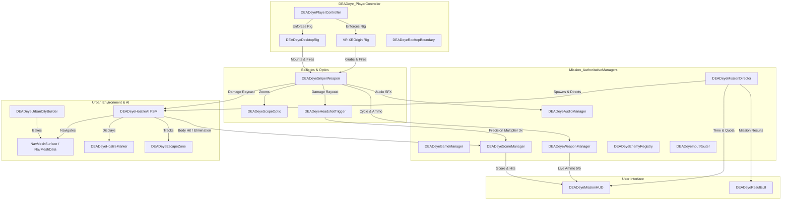

# DEADeye — Technical Architecture Specification

## 1. Architectural Philosophy & Scope Reduction

Following the **Final Scope Reduction Directive**, DEADeye has transitioned from a multi-scene dojo prototype into a high-performance, single-scene **Stationary Urban Rooftop Sniper Experience**.

### Architectural Pillars:
1. **Single-Scene Immediate Startup**: The entire application runs out of one authoritative scene (`Assets/DEADeye/Scenes/RooftopMission.unity` at Build Index 0). All boot delays, loading screens, and scene transitions have been removed.
2. **Stationary Player Rig**: The player is physically anchored to a 26-meter rooftop nest (`Y = 26.0m`). Walking locomotion has been eliminated, permanently preventing floor clipping, falling off edges, or disorienting movement speeds.
3. **Strict Mutual Exclusion**: Virtual Reality (`XROrigin`) and Desktop Simulation (`DEADeyeDesktopRig`) rigs are mutually exclusive. The `DEADeyePlayerController` detects hardware on start and enforces that only one rig is active.
4. **Deterministic NavMesh Navigation**: City streets and sidewalks are backed by a persistent baked `NavMeshData` asset (`Assets/DEADeye/Scenes/RooftopMission/NavMesh-CityEnvironment.asset`). Hostile AI units spawn snapped to NavMesh surfaces and patrol toward extraction corridors.
5. **Decoupled Event-Driven Telemetry**: HUD, audio, scoring, and AI communicate via C# multicast events (`OnHitRegistered`, `OnScoreUpdated`, `OnAmmoChanged`, `OnTimerTick`, `OnMissionEnded`).

---

## 2. System Architecture



---

## 3. Subsystem Breakdown

### 3.1 Authoritative Core Managers (`Mission_AuthoritativeManagers`)
- **`DEADeyeGameManager`**: Manages state transitions (`MissionActive`, `Paused`, `MissionResults`). Auto-detects desktop vs VR hardware.
- **`DEADeyeMissionDirector`**: Governs the 120-second mission countdown, hostile wave generation (initial wave of 3 immediately visible, total of 8), escape zone monitoring, and win/loss resolution.
- **`DEADeyeScoreManager`**: Records total score (100 pts body, 300 pts precision headshot), shots fired, shots hit, accuracy percentage, and miss count.
- **`DEADeyeWeaponManager`**: Enforces 5-round magazine capacity, bolt-action cooldown (0.85s), and reload replenishment.
- **`DEADeyeEnemyRegistry`**: Fast lookup and tracking of all active hostile entities in the city.
- **`DEADeyeAudioManager`**: Zero-dependency procedural waveform audio synthesizer (gunshots, bolt cycling, reloads, hit confirmations, ambient city rumble).
- **`DEADeyeInputRouter`**: Unifies mouse/keyboard and VR controller inputs while suppressing weapon discharge when hovering interactive UI elements.

### 3.2 Player Controller & Stationary Rig (`DEADeye_PlayerController`)
- **Stationary Positioning**: Root transform is fixed at `(0, 26.0, -2.5)`. Locomotion inputs are deactivated.
- **`DEADeyeDesktopRig`**: Provides mouse-look aiming (clamped pitch from -80° to +80°), automatic weapon mounting in foreground, RMB optic scope zoom, LMB firing with cooldown, R reload, and Esc pause toggle.
- **`DEADeyeRooftopBoundary`**: Physical safety barrier ensuring player camera stays within rooftop boundary coordinates.

### 3.3 Optics & Ballistics (`XM500_PrecisionSniper`)
- **`DEADeyeSniperWeapon`**: Hitscan ballistic raycaster with distance falloff, muzzle flash particle bursts, dynamic line-renderer bullet tracers, and procedural recoil recovery.
- **`DEADeyeScopeOptic`**: Real-time optical scope camera with magnified FOV (15°) rendering to a circular lens RenderTexture with an overlay reticle and center aiming pip.
- **`DEADeyeHeadshotTrigger`**: Precision spherical head hitbox (`Radius = 0.28m`) multiplying incoming damage by 3x and awarding 300 points.

### 3.4 Hostile AI & City Environment
- **`DEADeyeUrbanCityBuilder`**: Generates asphalt roadways, raised sidewalks, multi-story buildings with setbacks, streetlights, and escape corridors (Highway Tunnel, Subway Station, River Bridge).
- **`DEADeyeHostileAI`**: Finite State Machine controlling hostile behaviors:
  ```
  [Spawn] -> [Patrol] -> [Suspicious] -> [Alerted] -> [Escape] / [Eliminated]
  ```
- **`DEADeyeHostileMarker`**: Billboarding red downward-pointing triangle indicator rendered over every hostile target.

### 3.5 User Interface (`DEADeye_MissionHUD` & `DEADeyeResultsUI`)
- **COD Mobile Minimal HUD**:
  - Top Telemetry: `TIME 02:00 | SCORE 0000 | HOSTILES 8 | ESCAPES 0/3`
  - Bottom Ammo: `AMMO: 5 / 5 [R] RELOAD`
  - Dynamic Hit Banner: `+100 BODY HIT` or `+300 PRECISION HEADSHOT`
  - Full-Screen Tactical Pause Menu: Resume, Restart, Quit
- **Results Debriefing**: Displays mission outcome, final score, accuracy %, eliminations, and escapes with `[RESTART MISSION]` and `[QUIT GAME]` actions.
