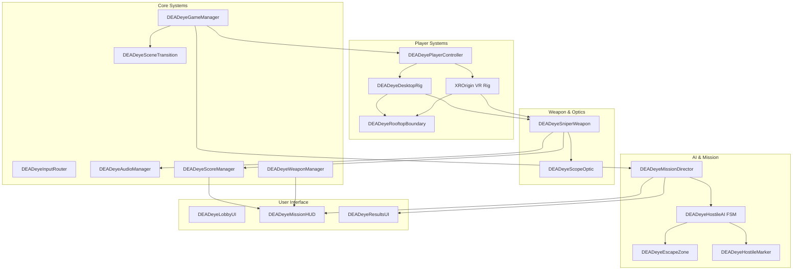
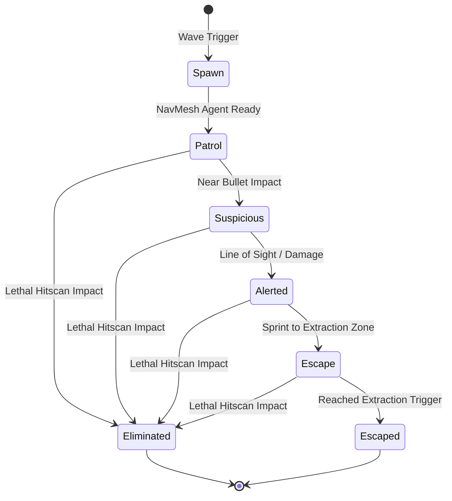
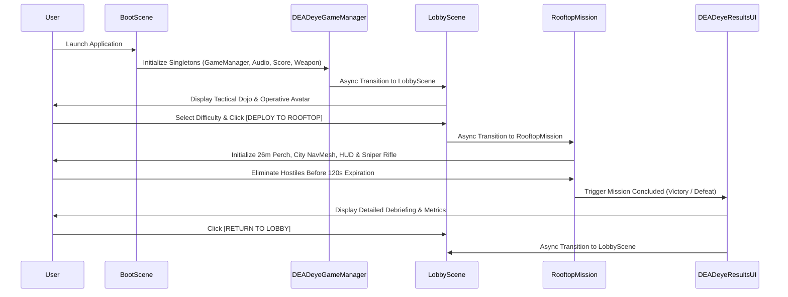

# DEADeye VR — Technical Architecture Specification

## 1. Architectural Philosophy & Design Principles

DEADeye VR is architected according to modern software engineering standards for real-time XR applications:
- **Single Responsibility Principle (SRP)**: Every script has one clear domain (e.g., input routing, audio synthesis, score tracking, optic rendering).
- **Loose Coupling via C# Events & Interfaces**: Subsystems communicate via multicast events (`OnStateChanged`, `OnScoreUpdated`, `OnHostileEliminated`, `OnAmmoChanged`) rather than hard dependencies.
- **Strict Mutual Exclusion for XR / Desktop Rigs**: Virtual Reality (`XROrigin`) and Desktop Simulation (`DEADeyeDesktopRig`) never run concurrently, preventing double-audio listeners, conflicting camera matrices, and duplicate input consumers.
- **Assembly Definition Boundaries**: Clean boundaries separating `DEADeye.Runtime`, `DEADeye.Editor`, `DEADeye.EditMode.Tests`, and `DEADeye.PlayMode.Tests`.

---

## 2. Subsystem Breakdown

### 2.1 Core Subsystems
- **`DEADeyeGameManager`**: Persistent singleton managing `DEADeyeGameState` (`Boot`, `Lobby`, `MissionBriefing`, `MissionActive`, `MissionDebriefing`, `MissionFailed`, `Paused`) and `MissionDifficulty` (`Recruit`, `Operative`, `Elite`).
- **`DEADeyeInputRouter`**: Centralizes input event routing for desktop and VR devices. Integrates `IsPointerOverUI()` suppression to ensure mouse clicks or controller triggers over UI elements do not discharge weapons.
- **`DEADeyeAudioManager`**: Procedural real-time waveform synthesizer. Synthesizes gunshots (transient noise + exponential decay), bolt cycling, reloads, hit chimes, and city ambient rumble without relying on external proprietary audio assets.
- **`DEADeyeScoreManager`**: Aggregates telemetry (shots fired, hits, precision headshots, accuracy %, combo streaks, total score) and dispatches real-time updates to listeners.
- **`DEADeyeWeaponManager`**: Enforces magazine capacity (5 rounds), bullet consumption, and cycling timers.
- **`DEADeyeSceneTransition`**: Performs asynchronous scene loading (`BootScene` -> `LobbyScene` -> `RooftopMission`) with smooth state synchronization.

### 2.2 Player & Boundary Subsystems
- **`DEADeyePlayerController`**: Evaluates `XRSettings.isDeviceActive` and presence of VR hardware. Enforces active rig state, disabling inactive components, cameras, and audio listeners.
- **`DEADeyeDesktopRig`**: Smooth FPS controller for desktop testing, supporting WASD movement, mouse pitch/yaw, weapon alignment socket, RMB scope aiming, and LMB weapon firing.
- **`DEADeyeRooftopBoundary`**: Clamps player transform within safe rooftop coordinates ($X \in [-12, 12]$, $Z \in [-12, 2]$ at $Y = 26$m), guaranteeing the player cannot clip or fall off the perimeter.

### 2.3 Weapon & Optical Systems
- **`DEADeyeSniperWeapon`**: Interactive ballistic rifle extending `XRGrabInteractable`. Features two-handed grab stabilization, hitscan ballistics raycasting with distance falloff, muzzle flash particle bursts, dynamic bullet tracer line renderers, and procedural recoil pitch and recovery.
- **`DEADeyeScopeOptic`**: Real-time optical scope rendering a zoomed perspective (4x / 8x FOV) onto a 512x512 circular RenderTexture lens. Features culling when unequipped to conserve mobile GPU fillrate.

### 2.4 AI & Mission Director
- **`DEADeyeHostileAI`**: Finite State Machine controlling urban hostile behaviors.
- **`DEADeyeMissionDirector`**: Governs wave generation, mission countdown (120s timer), extraction zone monitoring, and win/loss resolution.
- **`DEADeyeEscapeZone`**: Designated extraction checkpoints triggering hostile escapes and score penalties.

---

## 3. Scene Architecture & Routing

---

## 4. Assembly Definition Architecture

| Assembly | Path | Purpose |
| :--- | :--- | :--- |
| **`DEADeye.Runtime`** | `Assets/DEADeye/Scripts/DEADeye.Runtime.asmdef` | Core gameplay, AI, weapons, audio, UI, and player systems |
| **`DEADeye.Editor`** | `Assets/DEADeye/Editor/DEADeye.Editor.asmdef` | Automated scene generation and Android APK compilation pipeline |
| **`DEADeye.EditMode.Tests`** | `Assets/DEADeye/Tests/EditMode/DEADeye.EditMode.Tests.asmdef` | 10 unit and architectural integration test suites |
| **`DEADeye.PlayMode.Tests`** | `Assets/DEADeye/Tests/PlayMode/DEADeye.PlayMode.Tests.asmdef` | 5 end-to-end live gameplay test suites with in-engine screenshot captures |
