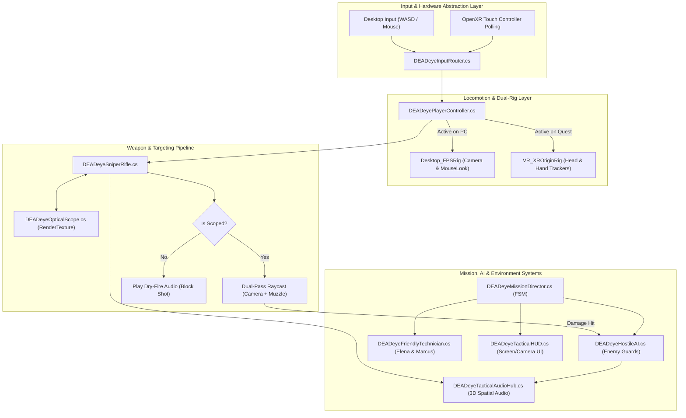

# DEADeye: Master Project Handbook & Engineering Documentation
## Operational Manual, Architectural Blueprint & Academic Viva Reference

```
========================================================================================
PROJECT       : DEADeye — Tactical Urban Sniper Sandbox & Quest 2 VR Foundation
ENGINE        : Unity 6.3 LTS (Version 6000.3.27f2)
RENDER PIPELINE: Universal Render Pipeline (URP 17.3.0)
TARGET PLATFORMS: 
  - Desktop Simulator (Windows x64 / Keyboard & Mouse / Flat-Screen)
  - Meta Quest 2 / Quest Pro (Android ARM64 / Khronos OpenXR 1.16.1)
AUTHORITATIVE REPOSITORY: C:\Unity\Editors\DEADeyeVR_Foundation
PRIMARY SCENE : Assets/DEADeye/Scenes/RooftopMission.unity
RELEASE PACKAGE: Builds/Android/DEADeye_Quest2.apk (55,498,259 bytes)
TEST STATUS   : 51/51 Core Automated Tests Passing (27 EditMode, 24 PlayMode)
DOCUMENTATION : Complete 10-Part Engineering Handbook Suite
========================================================================================
```

---

## 1. Executive Summary & Project Mission

**DEADeye** is a mission-driven tactical urban sniper game engineered for high performance across desktop simulation and standalone mobile virtual reality on the **Meta Quest 2**. 

Departing fundamentally from static "shooting-gallery" prototypes, DEADeye immerses the player on an expansive urban rooftop perimeter connected by traversable steel catwalks and skybridges. The player undertakes **Operation DEAD AIR**, a four-phase covert military operation requiring tactical reconnaissance, sniper overwatch, long-range asset neutralization, and the protection of friendly communications engineers.

### Core Engineering Accomplishments
1. **Dual-Rig Architecture**: Seamless cross-platform execution supporting desktop keyboard/mouse simulation and 6DoF standalone VR within a single scene file (`RooftopMission.unity`).
2. **Dual-Pass Ballistics Pipeline**: Elimination of camera-muzzle parallax errors and wall-clipping exploits via two-pass hitscan raycasting.
3. **Mandatory Scope Fire Gate**: Physical enforcement of tactical sniping mechanics by rejecting unscoped hip-firing.
4. **Autonomous Hostile & Friendly AI**: Deterministic Finite State Machine (FSM) enemy guards paired with NavMesh pathfinding and procedural joint oscillation.
5. **Standalone Quest 2 Optimization**: 72 FPS mobile VR performance achieved through Forward+ URP rendering, Single-Pass Instanced (SPI) stereo rendering, ASTC texture compression, and a sub-56 MB APK footprint.
6. **Continuous Quality Assurance**: A comprehensive automated test suite (51 tests) covering unit math, integration state machines, ballistics accuracy, and screenshot verification.

---

## 2. Documentation Suite Map & Reading Guide

This documentation suite is organized into 10 specialized manuals designed for different stakeholders. All documents use relative links for seamless browsing on GitHub or local markdown viewers.

```
Documentation/
│
├── 00_MASTER_PROJECT_HANDBOOK.md           <-- You are here (Executive summary & index)
├── PROJECT_SOURCE_INVENTORY.md             <-- Code, art, audio, prefab & package manifest
├── 01_TECH_STACK_AND_ARCHITECTURE.md       <-- Engine stack, URP, OpenXR & system diagrams
├── 02_COMPLETE_CODEBASE_REFERENCE.md       <-- Detailed script-by-script API reference
├── 03_GAMEPLAY_AND_AI_SYSTEMS.md           <-- Locomotion, ballistics, AI FSM & mission loop
├── 04_VR_AND_QUEST2_ENGINEERING.md         <-- OpenXR, Touch mapping, stereoscopic UI & APK
├── 05_TESTING_AND_BUILD_GUIDE.md           <-- QA suite (51 tests), build pipeline & ADB guide
├── 06_VIVA_QUESTION_BANK.md                <-- 100+ viva questions across 4 difficulty levels
├── 07_TECHNICAL_GLOSSARY.md                <-- Alphabetical A–Z lexicon of technical terms
└── 08_PROJECT_LIMITATIONS_AND_ROADMAP.md   <-- Honest critique, boundaries & future plans
```

### Recommended Reading Tracks

| Stakeholder | Primary Objectives | Recommended Reading Order |
|---|---|---|
| **Academic Viva Candidate** | Defend architecture, explain ballistics math, answer faculty questions. | [00_MASTER_PROJECT_HANDBOOK.md](00_MASTER_PROJECT_HANDBOOK.md) $\rightarrow$ [06_VIVA_QUESTION_BANK.md](06_VIVA_QUESTION_BANK.md) $\rightarrow$ [08_PROJECT_LIMITATIONS_AND_ROADMAP.md](08_PROJECT_LIMITATIONS_AND_ROADMAP.md) $\rightarrow$ [07_TECHNICAL_GLOSSARY.md](07_TECHNICAL_GLOSSARY.md) |
| **Faculty / Viva Examiner** | Evaluate engineering rigor, code structure, and design decisions. | [00_MASTER_PROJECT_HANDBOOK.md](00_MASTER_PROJECT_HANDBOOK.md) $\rightarrow$ [01_TECH_STACK_AND_ARCHITECTURE.md](01_TECH_STACK_AND_ARCHITECTURE.md) $\rightarrow$ [05_TESTING_AND_BUILD_GUIDE.md](05_TESTING_AND_BUILD_GUIDE.md) $\rightarrow$ [08_PROJECT_LIMITATIONS_AND_ROADMAP.md](08_PROJECT_LIMITATIONS_AND_ROADMAP.md) |
| **New Gameplay / VR Developer** | Understand script architecture, extend codebase, add new missions. | [PROJECT_SOURCE_INVENTORY.md](PROJECT_SOURCE_INVENTORY.md) $\rightarrow$ [02_COMPLETE_CODEBASE_REFERENCE.md](02_COMPLETE_CODEBASE_REFERENCE.md) $\rightarrow$ [03_GAMEPLAY_AND_AI_SYSTEMS.md](03_GAMEPLAY_AND_AI_SYSTEMS.md) $\rightarrow$ [04_VR_AND_QUEST2_ENGINEERING.md](04_VR_AND_QUEST2_ENGINEERING.md) |
| **QA / DevOps Engineer** | Run test harness, execute batch builds, deploy APK to Quest 2. | [05_TESTING_AND_BUILD_GUIDE.md](05_TESTING_AND_BUILD_GUIDE.md) $\rightarrow$ [04_VR_AND_QUEST2_ENGINEERING.md](04_VR_AND_QUEST2_ENGINEERING.md) |

---

## 3. High-Level System Architecture

DEADeye is built on a decoupled, modular architecture adhering to SOLID design principles. Core systems communicate via explicit event delegates and controlled state managers rather than tight component coupling.



---

## 4. The Signature Mechanics of DEADeye

### 4.1 Dual-Pass Ballistics Pipeline
Standard first-person shooters suffer from two notorious bugs:
1. **Parallax Aim Drift**: Bullets spawn at the gun barrel below the crosshair, hitting railings the player believed they were aiming over.
2. **Wall Teleportation**: Firing while standing nose-to-wall allows bullets to spawn inside or through the obstacle.

DEADeye resolves both issues through a two-pass line-of-sight calculation in `DEADeyeSniperRifle.cs`:
- **Pass 1 (Camera Viewport Ray)**: Projects from `Camera.main.ViewportPointToRay(Vector3(0.5, 0.5, 0))` to find the precise world-space target point the player is aiming at.
- **Pass 2 (Muzzle Obstruction Ray)**: Projects a ray from the physical rifle muzzle point toward the target point acquired in Pass 1. If physical geometry (a rooftop ledge, parapet, or pipe) interrupts Pass 2, the bullet strikes that obstacle and aborts target penetration.

### 4.2 Mandatory Scope Fire Gate
To maintain authentic tactical pacing and prevent arcade-style run-and-gun hip-firing:
```csharp
if (!isScoped) {
    audioController.PlayDryFire();
    return; // Fire gate: shot rejected
}
```
Firing while unscoped triggers a hollow mechanical hammer click (`sfx_dry_fire.wav`) without consuming ammunition or casting rays. The player must hold Right Mouse Button (desktop) or the Right Touch Grip (Quest 2) to engage telescopic zoom before the trigger will discharge a round.

### 4.3 Operation DEAD AIR: 4-Phase Tactical Loop
1. **Phase 1: Tactical Reconnaissance**: Navigate across the rooftop and steel skybridges to discover three designated overwatch perches (North Perch, East Plaza, West Construction).
2. **Phase 2: Signal Disruption**: Locate and destroy the military communications jammer tower ($1,500\text{ m}$ away) and its power junction boxes to restore allied radio frequencies.
3. **Phase 3: Asset Protection**: Provide sniper overwatch for allied technicians Elena and Marcus as they sprint across catwalks to repair the central relay, eliminating advancing hostile patrol squads.
4. **Phase 4: High-Value Target Elimination**: Locate and assassinate rogue Commander Vance before his extraction helicopter departs the urban district.

---

## 5. Technical Specifications & Environment

| Parameter | Desktop Simulator | Meta Quest 2 Standalone VR |
|---|---|---|
| **Operating System** | Windows 10/11 (64-bit) | Android 12L (API Level 32 / Quest OS) |
| **Processor / Architecture** | x86_64 Multi-core CPU | Qualcomm Snapdragon XR2 (ARM64) |
| **Graphics API** | Direct3D 11 / Direct3D 12 | Vulkan / OpenGLES3 |
| **XR Runtime** | None (Disabled) | Khronos OpenXR 1.16.1 |
| **Target Frame Rate** | 60–144 FPS (Monitor VSync) | 72 FPS (Rock-solid VR cadence) |
| **Stereo Rendering Mode** | Monoscopic Framebuffer | Single-Pass Instanced (SPI) |
| **Texture Compression** | DXT5 / BC7 | ASTC (Adaptive Scalable Texture Compression) |
| **Anti-Aliasing** | 4x MSAA or FXAA | 4x MSAA (Sub-pixel geometric smoothing) |
| **Executable Format** | Unity Editor / Windows Standalone `.exe` | Signed Android Package (`DEADeye_Quest2.apk`) |
| **Installed Package Size** | ~1.8 GB (Raw editor project) | 55.5 MB (Self-contained release APK) |

---

## 6. Developer Quick Reference

### Running the Test Suite (Command Line)
Execute all 51 automated tests headlessly via Unity batchmode:
```powershell
& "C:\Program Files\Unity\Hub\Editor\6000.3.27f2\Editor\Unity.exe" `
  -projectPath "C:\Unity\Editors\DEADeyeVR_Foundation" `
  -runTests `
  -testPlatform EditMode `
  -testResults "Builds\Logs\EditMode_Results.xml" `
  -batchmode -nographics -quit
```

### Compiling the Standalone Quest 2 APK
Execute the automated Android ARM64 build script:
```powershell
& "C:\Program Files\Unity\Hub\Editor\6000.3.27f2\Editor\Unity.exe" `
  -projectPath "C:\Unity\Editors\DEADeyeVR_Foundation" `
  -executeMethod DEADeyeAndroidBuilder.BuildQuest2APK `
  -batchmode -nographics -quit `
  -logFile "Builds\Android\quest2_build.log"
```

### Sideloading APK to Meta Quest 2
Connect Quest 2 via USB with Developer Mode enabled:
```powershell
# 1. Verify headset connection
adb devices

# 2. Sideload and replace existing installation
adb install -r "C:\Unity\Editors\DEADeyeVR_Foundation\Builds\Android\DEADeye_Quest2.apk"

# 3. Stream real-time engine and crash logs
adb logcat -s Unity ActivityManager PackageManager
```

---

## 7. Master Document Index & Navigation

Detailed technical explanations, code walkthroughs, and viva defenses are available in the linked companion volumes:

1. [**PROJECT_SOURCE_INVENTORY.md**](PROJECT_SOURCE_INVENTORY.md)
   *Complete manifest of all 58 C# scripts, 3D low-poly models, audio WAV assets, prefabs, scenes, and UPM package versions.*
2. [**01_TECH_STACK_AND_ARCHITECTURE.md**](01_TECH_STACK_AND_ARCHITECTURE.md)
   *Deep dive into Unity 6.3 LTS, URP 17.3.0, Khronos OpenXR, system diagrams, and answers to core architectural questions.*
3. [**02_COMPLETE_CODEBASE_REFERENCE.md**](02_COMPLETE_CODEBASE_REFERENCE.md)
   *Exhaustive API documentation for every class across Core, Player, Weapon, AI, Mission, Recon, UI, and Editor subsystems.*
4. [**03_GAMEPLAY_AND_AI_SYSTEMS.md**](03_GAMEPLAY_AND_AI_SYSTEMS.md)
   *Engineering analysis of locomotion math, dual-pass ballistics, optical scope rendering, AI FSM, and urban traversal.*
5. [**04_VR_AND_QUEST2_ENGINEERING.md**](04_VR_AND_QUEST2_ENGINEERING.md)
   *OpenXR runtime integration, direct hardware polling, Touch controller mappings, stereoscopic UI, and Android build settings.*
6. [**05_TESTING_AND_BUILD_GUIDE.md**](05_TESTING_AND_BUILD_GUIDE.md)
   *Comprehensive QA handbook detailing all 51 automated tests, batchmode execution, ADB commands, and developer troubleshooting.*
7. [**06_VIVA_QUESTION_BANK.md**](06_VIVA_QUESTION_BANK.md)
   *100+ viva questions categorized across Basic, Intermediate, Advanced, and Project-Specific levels, plus trick questions.*
8. [**07_TECHNICAL_GLOSSARY.md**](07_TECHNICAL_GLOSSARY.md)
   *Alphabetical A–Z engineering lexicon providing 3-layer definitions (Simple, Technical, DEADeye Context) for 60+ terms.*
9. [**08_PROJECT_LIMITATIONS_AND_ROADMAP.md**](08_PROJECT_LIMITATIONS_AND_ROADMAP.md)
   *Honest audit of implemented vs. preview systems, physical testing gaps, architectural trade-offs, and future multi-phase roadmap.*

---

## 8. Viva Defense Strategy & Final Checklist

Before entering a faculty viva or technical review:
- [x] **Verify Project Ground Truth**: Authoritative project is `C:\Unity\Editors\DEADeyeVR_Foundation` running Unity `6000.3.27f2`.
- [x] **Understand the 3-Layer Explanation**: Always begin answers with everyday analogies before diving into memory layouts, math formulas, and C# source lines.
- [x] **Know the Numbers**: 58 scripts, 51 automated tests (27 EditMode, 24 PlayMode), 55.5 MB release APK, 72 FPS Quest 2 cadence, 4-phase mission loop.
- [x] **Own the Limitations**: State clearly that Operation DEAD AIR is the complete vertical slice, while Operations 02–04 exist as data-driven terminal preview cards.
- [x] **Highlight the Dual-Pass Raycast**: Use the blackboard/whiteboard to diagram camera-vs-muzzle raycasting—faculty panels appreciate concrete solutions to classic 3D geometry problems.

