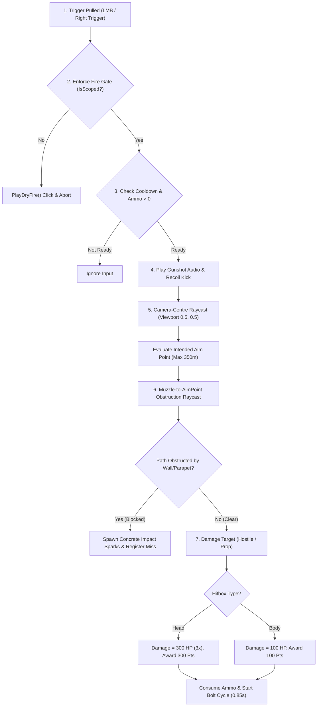
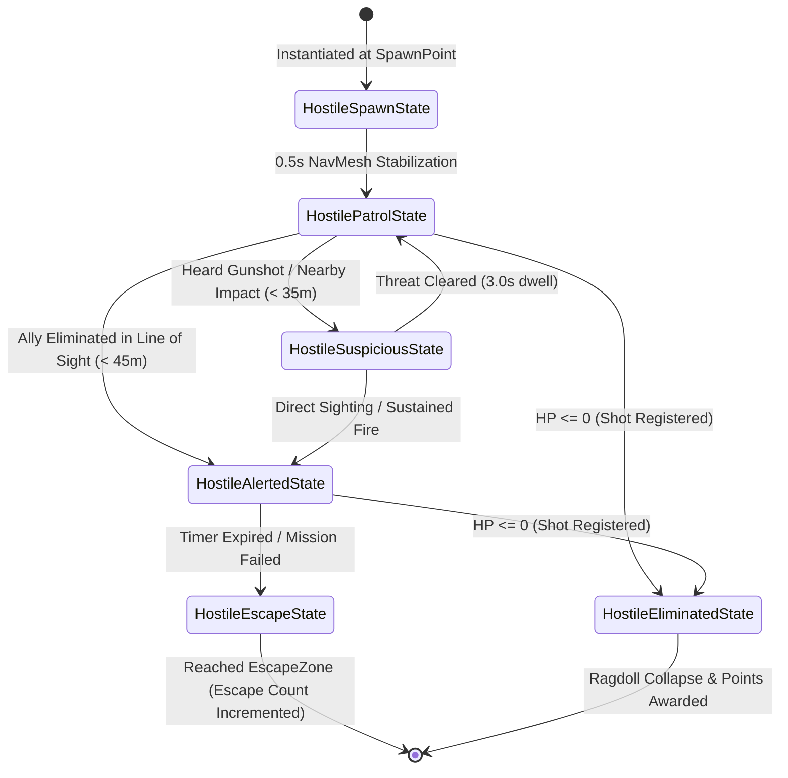

# DEADeye VR — Gameplay, Weapons, AI & Level Design Engineering

This handbook provides an exhaustive, mathematically grounded deep dive into the four gameplay pillars of **DEADeye VR**: the Player Locomotion system, the Sniper Ballistics & Optical Scope pipeline, the Finite State Machine Enemy & Friendly AI, and the Mission Campaign architecture.

---

## 1. Player Architecture & Locomotion

### A. The Dual-Rig Separation
In `Assets/DEADeye/Scripts/Player/DEADeyePlayerController.cs`, the player is architected as two mutually exclusive hierarchies under the `DEADeye_PlayerController` root:

```text
DEADeye_PlayerController
├── Desktop_FPSRig (Active on Desktop)
│   ├── CharacterController (Height: 1.8m, Radius: 0.35m, Step: 0.4m, Slope: 45°)
│   ├── DEADeyeDesktopRig (Locomotion, Pitch/Yaw math, ADS weapon positioning)
│   └── DesktopCamera (FOV: 60° normal / 32° ADS, Tag: MainCamera)
│       └── DesktopWeaponSocket (Hip: (0.22, -0.20, 0.58) | ADS: (0.00, -0.155, 0.36))
└── VR_XROriginRig (Active in Standalone VR)
    ├── XROrigin (Tracking Origin: Floor)
    ├── CharacterController
    ├── LocomotionMediator + DynamicMoveProvider + SnapTurnProvider
    └── Camera Offset
        ├── Main Camera (TrackedPoseDriver, Stereo Eye Rendering, URP Camera Data)
        ├── Left Controller (TrackedPoseDriver, Locomotion stick, Ray/Poke Interactors)
        └── Right Controller (TrackedPoseDriver, VRWeaponSocket, Trigger/Grip Interactors)
```

### B. Desktop Mouse Look Math (Zero-Drift Architecture)
In `DEADeyeDesktopRig.cs`, camera rotation is calculated from raw hardware pixel deltas provided by `DEADeyeInputRouter.cs`:

$$\text{Yaw}_{t} = \text{Yaw}_{t-1} + (\Delta X \cdot S_H)$$
$$\text{Pitch}_{t} = \text{Clamp}\Big(\text{Pitch}_{t-1} - (\Delta Y \cdot S_V), -85^{\circ}, +85^{\circ}\Big)$$

Where $S_H = 0.12$ and $S_V = 0.12$ degrees per pixel.
- **Why this works**: Virtual axes (`Input.GetAxis("Mouse X")`) apply software smoothing that can drift when the physical mouse stops moving. By reading raw pixel displacement (`Mouse.current.delta.ReadValue()`), when $\Delta X = 0, \Delta Y = 0$, rotation is completely static, eliminating jitter during high-magnification sniping.

### C. Rooftop Boundary & Fall Recovery
`DEADeyeRooftopBoundary.cs` monitors the player's world position:
- Rooftop level: $Y \approx 26.0\text{ m}$.
- City street level: $Y \approx 0.15\text{ m}$.
- Threshold: If `player.transform.position.y < minimumSafeY (18.0m)` AND `!characterController.isGrounded`:
  The player has slipped off a rooftop or bridge. The controller immediately zeroes velocity and respawns the player at the nearest safe perch node (`perch1SafePos`, `perch2SafePos`, or `perch3SafePos`) without reloading the scene.

---

## 2. Sniper Weapon & Ballistics Architecture

### A. The 7-Step Firing Pipeline
The sniper rifle (`XM500_PrecisionSniper` running `DEADeyeSniperWeapon.cs`) executes an authoritative 7-stage pipeline on every trigger press:



### B. Camera-Centre Targeting Math
A common defect in FPS games is "parallax error": the camera is at eye level, while the weapon muzzle is 30cm lower and 20cm to the right. If the weapon simply fires straight along the barrel forward vector, the bullet hits below and to the right of the crosshair.

DEADeye eliminates parallax error through a 2-pass targeting algorithm:
1. **Camera Pass**:
   $$\vec{R}_{\text{aim}} = \text{ViewportPointToRay}(0.5, 0.5)$$
   $$\vec{P}_{\text{aim}} = \text{FirstValidHit}(\vec{R}_{\text{aim}}) \quad \text{or} \quad \vec{R}_{\text{origin}} + \vec{R}_{\text{dir}} \times 350\text{m}$$
2. **Muzzle Trajectory Pass**:
   $$\vec{D}_{\text{muzzle}} = \frac{\vec{P}_{\text{aim}} - \vec{P}_{\text{muzzle}}}{\|\vec{P}_{\text{aim}} - \vec{P}_{\text{muzzle}}\|}$$
   $$\text{Dist} = \|\vec{P}_{\text{aim}} - \vec{P}_{\text{muzzle}}\|$$
3. **Muzzle Obstruction Pass**:
   Casts a ray from $\vec{P}_{\text{muzzle}}$ along $\vec{D}_{\text{muzzle}}$ for $\text{Dist} + 0.15\text{m}$.
   - If an obstacle (e.g., concrete parapet) is hit closer than $\vec{P}_{\text{aim}}$, the bullet impacts the obstacle.
   - If no obstacle intervenes, the bullet hits $\vec{P}_{\text{aim}}$ with pinpoint accuracy.

### C. Procedural Recoil & Bolt-Action Recovery
In `DEADeyeSniperWeapon.Update()`:
Upon firing:
$$\text{RecoilOffset} = (0.00\text{m}, +0.02\text{m}, -0.08\text{m})$$
$$\text{RecoilRotation} = \text{Euler}(-4.5^{\circ}, \text{Random}(-0.4^{\circ}, 0.4^{\circ}), 0^{\circ})$$
Every frame:
$$\text{Offset}_t = \text{Lerp}(\text{Offset}_{t-1}, \vec{0}, \Delta t \cdot 12)$$
$$\text{Rotation}_t = \text{Slerp}(\text{Rotation}_{t-1}, \text{Quaternion.identity}, \Delta t \cdot 12)$$
This provides a punchy physical kickback followed by a smooth mechanical return, simulating the bolt-action rifle cycle.

---

## 3. Optical Scope System (`DEADeyeScopeOptic.cs`)

### A. Dual-Lens Render Architecture
The optical scope does not simply zoom the main camera. It uses a true dual-camera optical pipeline:
1. **Main Player Camera**: Renders the player's peripheral vision at normal FOV (60°).
2. **Scope Camera (`scopeCamera`)**: Mounted inside the rifle's physical scope housing, angled strictly along the barrel axis.
   - Field of View: 12.0° (~5x optical magnification).
   - High Zoom Mode: 6.0° (~10x optical magnification).
   - Target Texture: `RT_SniperScopeLens` (1024x1024, ARGB32, 24-bit depth, 4x MSAA).
3. **Physical Scope Mesh**: The cylindrical optic lens material displays `RT_SniperScopeLens`.
4. **HUD Reticle Overlay**: When zoomed in, `DEADeyeMissionHUD` displays the lens texture centered on screen within a dark circular vignette and fine mil-dot sniper crosshairs.

### B. Performance Optimization
Rendering a secondary camera doubles the scene draw calls if left active continuously. In `DEADeyeScopeOptic.cs`:
```csharp
public void SetScopeActive(bool active)
{
    isAiming = active;
    if (scopeCamera != null) scopeCamera.enabled = active;
    if (lensRenderer != null) lensRenderer.enabled = active;
    if (DEADeyeMissionHUD.Instance != null)
    {
        DEADeyeMissionHUD.Instance.SetScopeOverlay(active);
    }
}
```
When unscoped, `scopeCamera.enabled = false`. The second render pass is completely deactivated, saving 50% of GPU rendering cycles during normal movement.

---

## 4. Artificial Intelligence & NPC Architecture

### A. Hostile AI Finite State Machine (`DEADeyeHostileAI.cs`)
All enemies inherit from `DEADeyeHostileAI` and are controlled by an `IEnemyState` state pattern driven by Unity's `NavMeshAgent`:



### B. Enemy Archetypes
1. **Hostile Criminal (`DEADeyeHostileCriminal.cs`)**:
   - Health: 100 HP.
   - Movement: Patrols at $1.6\text{ m/s}$, alerts to sprint at $2.8\text{ m/s}$.
   - Behavior: Seeks fountain and vehicle cover when fired upon.
2. **Commander Vance (`commanderPrefab`)**:
   - Health: 200 HP (Requires 1 headshot or 2 body shots).
   - Escort: Spawns in Phase 4 with 2 armed security guards.
   - Objective: Heads directly toward the Construction Site transport evac.
3. **Friendly Technicians Elena & Marcus (`DEADeyeFriendlyAI.cs`)**:
   - Health: 100 HP.
   - Repair Progress: Increments 0% &rarr; 100% over 28 seconds while at the Comms Console.
   - Vulnerability: Drops into crouch/cover if enemy bullets pass within 8 meters.

### C. Procedural Skeletal Animation (`DEADeyeProceduralCharacterAnimator.cs`)
To avoid rigid T-poses or requiring hundreds of animation clips, characters use mathematical procedural animation:

$$\theta_{\text{leg}}(t) = \sin(\omega t) \cdot A_{\text{swing}}$$
$$\theta_{\text{arm}}(t) = -\sin(\omega t) \cdot A_{\text{swing}}$$
$$Y_{\text{torso}}(t) = Y_0 + |\sin(\omega t)| \cdot 0.04\text{m}$$

Where $\omega = \text{agent.velocity.magnitude} \cdot 6.0$ rad/s.
This generates natural foot planting, arm swings opposing leg movement, and subtle torso bobbing that scales smoothly with agent movement speed.

---

## 5. Mission Campaign — Operation DEAD AIR

### The 5 Sequential Phases
The campaign is driven by `DEADeyeMissionDirector.cs`:

| Phase | Phase Name | Primary Tactical Objective | Success Trigger | Failure Condition |
|---|---|---|---|---|
| **Phase 1** | **Reconnaissance** | Observe and identify key targets through optical scope dwell (0.85s) | Dwell-spot Comms Jammer, Elena & Marcus, and Vance | Timer expires |
| **Phase 2** | **Disruption** | Disable the Military Comms Jammer | Shoot high-voltage Power Junction prop or Jammer array | Timer expires |
| **Phase 3** | **Technician Advance** | Provide sniper overwatch as Elena & Marcus repair the Comms Console | Comms repair reaches 100% | Either technician killed |
| **Phase 4** | **Neutralize Commander** | Eliminate Commander Vance before he reaches the evacuation transport | Vance health reaches 0 HP | Vance reaches escape zone |
| **Phase 5** | **Convoy Extraction** | Neutralize final ambush squad to allow convoy retrieval | All remaining hostiles eliminated | Escapes exceed max limit |

### Debriefing & Grading Algorithm
Upon mission conclusion, `DEADeyeResultsUI.cs` calculates the operative's performance grade:
- **Base Score**: 100 points per body hit, 300 points per headshot, 500 points per objective.
- **Accuracy Bonus**:
  $$\text{Score}_{\text{final}} = \text{Score}_{\text{base}} \times \left(1.0 + \frac{\text{Accuracy}\%}{100}\right) - (\text{Escapes} \times 250)$$
- **Grades**:
  - **S Rank**: 0 Escapes, Accuracy $\ge 85\%$, Score $\ge 2,500$.
  - **A Rank**: Escapes $\le 1$, Accuracy $\ge 70\%$, Score $\ge 1,800$.
  - **B Rank**: Escapes $\le 2$, Accuracy $\ge 50\%$, Score $\ge 1,200$.
  - **C Rank**: Mission complete, Escapes $\le 2$.
  - **F Rank**: Any critical VIP killed or Escapes $> 2$.

---

## 6. Procedural Urban Environment (`DEADeyeUrbanCityBuilder.cs`)

The city is procedurally constructed on startup into 4 cohesive tactical districts:

```text
                                [North Overwatch Perch 1]
                                          |
                +-------------------------+-------------------------+
                |                                                   |
      [West Skybridge]                                      [East Catwalk]
                |                                                   |
    [West Overwatch Perch 3]                             [East Overwatch Perch 2]
                |                                                   |
    ==================== BOULEVARD (4 Lanes) =====================
    [Construction Site]     [Central Commercial Plaza]     [Residential Area]
    - 4-Floor Skeleton      - Communications Tower         - Brownstones & Alleys
    - Tower Crane & Spans   - Military Jammer Array        - Shootable Security Gate
    - Transformer Prop      - High-Voltage Power Junction  - Narrow Sightlines
    - Vance Spawn           - Elena & Marcus Console
```

### Walkable Steel Bridges & Sightlines
- **East Catwalk**: Connects Perch 1 to Perch 2 ($18\text{m}$ span, $2.4\text{m}$ width). Overlooks the Central Plaza and Comms Tower.
- **West Skybridge**: Connects Perch 1 to Perch 3 ($18\text{m}$ span, $2.4\text{m}$ width). Overlooks the Construction Site and transport boulevard.
- Both bridges feature physical box collider railings ($1.1\text{m}$ height), allowing the player to walk freely between perches using WASD without slipping off.

