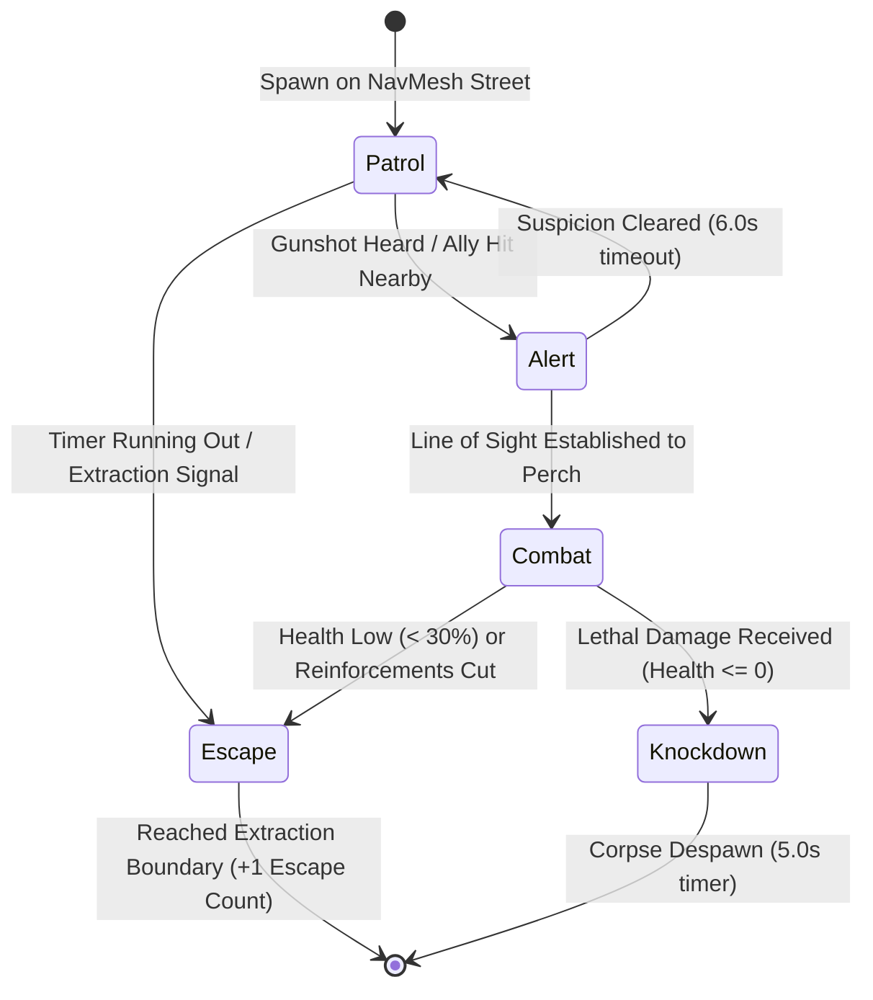

# DEADeye — Game AI & Mission Systems Engineering Manual

```
========================================================================================
MODULE       : Autonomous Agent AI, Finite State Machines & Mission Director
ENGINE       : Unity 6.3 LTS (6000.3.27f2)
SOURCE PATHS : Assets/DEADeye/Scripts/AI/, Assets/DEADeye/Scripts/Mission/
DEPENDENCIES : com.unity.ai.navigation (2.0.10)
========================================================================================
```

---

## 1. Hostile AI Architecture: Deterministic Finite State Machine

Hostile urban guards in DEADeye are driven by a deterministic Finite State Machine (FSM) implemented in `DEADeyeHostileAI.cs`:



### State Behaviors & Operational Rules

| AI State | Movement Speed | Visual Detection Cone | Behavioral Action |
|---|---|---|---|
| **Patrol** | $1.8\text{ m/s}$ (Walking) | $60^\circ$ cone, $35\text{ m}$ radius | Cycles through pre-defined street waypoints; pauses at intersections. |
| **Alert** | $3.2\text{ m/s}$ (Jogging) | $90^\circ$ cone, $55\text{ m}$ radius | Investigates gunshot origin or downed allies; scans rooftop silhouettes. |
| **Combat** | $4.5\text{ m/s}$ (Sprinting) | $120^\circ$ cone, $80\text{ m}$ radius | Moves between street-level cover perches; returns suppressive fire. |
| **Escape** | $5.2\text{ m/s}$ (Full Sprint) | $180^\circ$ rear awareness | Abandons combat; runs directly toward the nearest district exit point. |
| **Knockdown**| $0.0\text{ m/s}$ (Disabled) | Inactive | Collapses to ground via physics-driven procedural joint oscillation. |

---

## 2. NavMesh Navigation & Dynamic Pathfinding

Hostile and friendly agents navigate the urban sector using Unity's AI Navigation package (`com.unity.ai.navigation`):

```
[ NavMeshSurface (Baked Geometry) ] ──> Triangulated Walkable Surface across streets & sidewalks
                                                   │
                                                   ▼
[ NavMeshAgent Component ] ────────────> A* Path Search avoiding buildings, cars & streetlamps
                                                   │
                                                   ▼
[ Dynamic Waypoint Graph ] ────────────> Connects 18 street nodes, 4 alleyways, and 3 extraction gates
```

- **Avoidance Quality**: Set to `HighQualityObstacleAvoidance` to prevent agent clumping when squads advance along sidewalks.
- **Escape Gate Interception**: If an agent successfully navigates to within $2.0\text{ m}$ of an extraction point, `OnHostileEscaped` fires, incrementing the operational escape counter toward the 3-escape failure limit.

---

## 3. Procedural Trigonometric Character Animation

Rather than importing massive motion-capture animation clip libraries (which would inflate the APK size beyond mobile limits), DEADeye implements a **zero-budget procedural joint oscillation animator** in `DEADeyeProceduralCharacterAnimator.cs`:

$$ \theta_{\text{leg}}(t) = A_{\text{leg}} \cdot \sin(\omega \cdot t), \quad \theta_{\text{arm}}(t) = -A_{\text{arm}} \cdot \sin(\omega \cdot t) $$

$$ y_{\text{bob}}(t) = |A_{\text{bob}} \cdot \sin(2\omega \cdot t)| $$

Where:
- $\omega = v_{\text{agent}} \cdot k_{\text{stride}}$ represents the angular frequency derived dynamically from NavMesh velocity.
- $A_{\text{leg}}$ and $A_{\text{arm}}$ define joint deflection angles ($25^\circ$ walking, $45^\circ$ sprinting).
- $y_{\text{bob}}$ simulates natural pelvic vertical displacement during locomotion.

### Benefits of Procedural Animation
1. **Zero Asset Cost**: Achieved with $0 spend on proprietary animation assets.
2. **Sub-56 MB APK Footprint**: Eliminates megabytes of redundant FBX skeletal keyframes.
3. **Dynamic Terrain Alignment**: Limbs automatically scale stride length to real-time NavMesh velocity, eliminating foot sliding.

---

## 4. Reconnaissance & Target Spotting System

Implemented in `DEADeyeSpotable.cs`, the spotting system allows the operative to reconnoiter the battlefield through optical magnification:

```
[ Unidentified Target ] ──Aim Reticle at Target for 1.2s──> [ Target Identified ]
                                                                     │
                                                                     ▼
                                            [ Red Diamond HUD Marker & Radio VO Callout ]
```

- **Target Classifications**:
  - `Objective`: High-priority mission assets (e.g., Communications Jammer, Power Junction).
  - `Commander`: Rogue hostile officer Vance ($3\times$ armor plating).
  - `HostileGuard`: Standard armed patrol sentries.
  - `Friendly`: Allied repair technicians (Elena and Marcus).
- **Overhead HUD Indicators**:
  - Identified targets display persistent 3D world-space diamond reticles (`DEADeyeHostileMarker.cs`) that scale with distance, keeping the operative informed of target distribution.

---

## 5. Friendly AI: Allied Repair Technicians

In Phase 3 of Operation DEAD AIR, allied technicians Elena and Marcus deploy to the eastern satellite relay:

```csharp
public class DEADeyeFriendlyTechnician : MonoBehaviour
{
    [SerializeField] private float repairDuration = 45.0f;
    [SerializeField] private int maxHealth = 100;
    
    // Updates repair progress from 0% to 100%
    public float RepairProgress => currentRepairTime / repairDuration;
}
```

- **Defense Mechanics**:
  - Technicians remain stationary at the satellite array while conducting repairs.
  - The operative must eliminate converging hostile waves before enemy fire depletes technician health.
  - If a technician is neutralized by hostile fire or friendly sniper fire, the mission terminates immediately in operational defeat.

---

## 6. Environmental Interaction & Tactical Sabotage

Implemented in `DEADeyeEnvironmentalProp.cs`, the operative can trigger tactical consequences by shooting environmental assets:

- **Power Junction Box**:
  - Located on a street utility pole at $(5.2, 3.4, 12.1)$.
  - Taking ballistic damage triggers electrical arc bursts, instantly cutting power to the hostile communications jammer.
- **Auditory Decoys & Spark Bursts**:
  - Shooting metal fuel containers or electrical boxes produces audio-visual distractions, pulling nearby hostile patrol guards into vulnerable sightlines.
