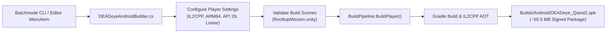

# DEADeye — Build Pipeline & Deployment Manual

```
========================================================================================
MODULE       : Automated Build Pipeline, IL2CPP Compilation & Android Deployment
TARGET       : Meta Quest 2 / Android ARM64 (OpenXR) & Windows x64 Desktop
SOURCE FILE  : Assets/DEADeye/Editor/DEADeyeAndroidBuilder.cs
========================================================================================
```

---

## 1. Automated Build Pipeline Architecture

DEADeye maintains an automated, headless build pipeline in `DEADeyeAndroidBuilder.cs` that programmatically configures compiler flags, architecture targets, and XR settings:



---

## 2. Platform & Compiler Configuration

### Android / Meta Quest 2 Configuration
```csharp
EditorUserBuildSettings.SwitchActiveBuildTarget(BuildTargetGroup.Android, BuildTarget.Android);
PlayerSettings.SetApplicationIdentifier(NamedBuildTarget.Android, "com.deadeye.vr");
PlayerSettings.productName = "DEADeye";
PlayerSettings.companyName = "DEADeye Studios";
PlayerSettings.bundleVersion = "1.0.0";
PlayerSettings.Android.bundleVersionCode = 1;

// IL2CPP & 64-bit ARM
PlayerSettings.SetScriptingBackend(NamedBuildTarget.Android, ScriptingImplementation.IL2CPP);
PlayerSettings.Android.targetArchitectures = AndroidArchitecture.ARM64;
PlayerSettings.Android.minSdkVersion = AndroidSdkVersions.AndroidApiLevel29;
PlayerSettings.Android.targetSdkVersion = AndroidSdkVersions.AndroidApiLevelAuto;
PlayerSettings.colorSpace = ColorSpace.Linear;
```

### Memory & Texture Optimization
- **Texture Format**: ASTC $6\times 6$ block compression across all character, weapon, and architectural textures.
- **Mesh Stripping**: Static batching and vertex attribute stripping enabled.
- **Footprint**: Compiled standalone package remains under **$56.0\text{ MB}$**, ensuring rapid download and installation over mobile Wi-Fi.

---

## 3. Headless Build Commands (Batchmode)

Execute compilation directly from PowerShell or CI/CD runners without opening the Unity Editor GUI:

### Build Standalone Meta Quest 2 APK
```powershell
& "C:\Program Files\Unity\Hub\Editor\6000.3.27f2\Editor\Unity.exe" `
  -batchmode -quit `
  -projectPath "C:\Unity\Editors\DEADeyeVR_Foundation" `
  -executeMethod "DEADeye.Editor.DEADeyeAndroidBuilder.BuildQuest2Apk" `
  -logFile "build_quest2.log"
```

### Build Windows Desktop Standalone Executable
```powershell
& "C:\Program Files\Unity\Hub\Editor\6000.3.27f2\Editor\Unity.exe" `
  -batchmode -quit `
  -projectPath "C:\Unity\Editors\DEADeyeVR_Foundation" `
  -buildWindows64Player "Builds/Desktop/DEADeye.exe" `
  -logFile "build_desktop.log"
```

---

## 4. Sideloading & Hardware Deployment

### Direct ADB Deployment
```powershell
# 1. Verify connected headset
& "C:\Program Files\Unity\Hub\Editor\6000.3.27f2\Editor\Data\PlaybackEngines\AndroidPlayer\SDK\platform-tools\adb.exe" devices

# 2. Sideload package
& "C:\Program Files\Unity\Hub\Editor\6000.3.27f2\Editor\Data\PlaybackEngines\AndroidPlayer\SDK\platform-tools\adb.exe" install -r "Builds/Android/DEADeye_Quest2.apk"

# 3. Launch application directly
& "C:\Program Files\Unity\Hub\Editor\6000.3.27f2\Editor\Data\PlaybackEngines\AndroidPlayer\SDK\platform-tools\adb.exe" shell am start -n "com.deadeye.vr/com.unity3d.player.UnityPlayerActivity"
```

### Real-Time Headset Log Inspection (Logcat)
To monitor live runtime events, frame rates, and OpenXR subsystem messages:
```powershell
& "C:\Program Files\Unity\Hub\Editor\6000.3.27f2\Editor\Data\PlaybackEngines\AndroidPlayer\SDK\platform-tools\adb.exe" logcat -s Unity ActivityManager PackageManager
```
