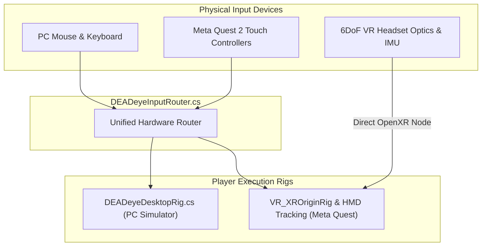

# DEADeye — Control Systems & Input Mapping Reference

```
========================================================================================
MODULE       : Input Abstraction & Hardware Interface Mapping
SOURCE FILE  : Assets/DEADeye/Scripts/Core/DEADeyeInputRouter.cs
TARGETS      : PC Desktop Simulator (KBM) & Meta Quest 2 / Touch Controllers
========================================================================================
```

---

## 1. Input Architecture Overview

DEADeye utilizes an authoritative hardware abstraction router (`DEADeyeInputRouter.cs`) that decouples high-level gameplay actions (e.g., `GetFireDown()`, `GetScopeHeld()`, `GetReloadDown()`) from physical hardware devices:



---

## 2. PC Desktop Simulator Controls

Designed following conventional PC tactical first-person shooter conventions:

| Input | Gameplay Action | Mechanical Behavior |
|---|---|---|
| **Mouse Movement** | Camera Aiming / Free Look | Rotates camera pitch and yaw. Cursor locked to viewport. |
| **W / A / S / D** | Locomotion Movement | Moves operative across perches, catwalks, and skybridges. |
| **Hold RMB** (Right Mouse) | Optical Scope Zoom | Engages dual-lens sniper optic; drops FOV to $12^\circ$ or $6^\circ$. |
| **LMB while Scoped** | Fire Sniper Rifle | Discharges 1 round from magazine; triggers ballistic raycast. |
| **LMB without Scope** | Fire Gated (Safety Block) | Firing blocked; emits safety click and HUD scope warning. |
| **R** | Reload Magazine | Initiates 2.2-second tactical reload; replenishes 5-round magazine. |
| **Space** | Jump | Traverses minor elevation changes and platform steps. |
| **Y** | Tactical Terminal Toggle | Opens or closes the mission operations terminal. |
| **Escape** | Pause Menu | Halts mission simulation; displays settings and options. |

### Desktop Cursor & Sensitivity Tuning
- **Cursor Locking**: Upon clicking into the game viewport, the mouse cursor is locked and hidden (`Cursor.lockState = CursorLockMode.Locked`). Pressing `Escape` unlocks and displays the OS pointer.
- **Sensitivity Parameters**: Configured directly in `DEADeyeInputRouter.cs`:
  - `horizontalSensitivity`: $0.12^\circ / \text{pixel}$ (configurable between $0.01$ and $2.0$).
  - `verticalSensitivity`: $0.12^\circ / \text{pixel}$ (configurable between $0.01$ and $2.0$).

---

## 3. Meta Quest 2 Standalone VR Controls

Full 6DoF motion controller mapping engineered for the **Meta Quest Touch (Left & Right)** controllers:

```
        LEFT TOUCH CONTROLLER                      RIGHT TOUCH CONTROLLER
        +-------------------+                      +-------------------+
        |  [Thumbstick]     |                      |  [Thumbstick]     |
        |  Catwalk Move     |                      |  (Unused)         |
        |                   |                      |                   |
        |  [Button Y]       |                      |  [Button B]       |
        |  Tactical Terminal|                      |  Mission Info HUD |
        |                   |                      |                   |
        |  [Button X]       |                      |  [Button A]       |
        |  Reload Magazine  |                      |  Reload Magazine  |
        |                   |                      |                   |
        |  [Menu Button]    |                      |  [Right Trigger]  |
        |  Pause Mission    |                      |  Fire Sniper      |
        |                   |                      |                   |
        |  [Grip Squeeze]   |                      |  [Right Grip]     |
        |  (Secondary Hold) |                      |  Optical Scope    |
        +-------------------+                      +-------------------+
```

| Controller | Input Control | In-Game Function | Hardware Interface |
|---|---|---|---|
| **Headset** | Physical Head Turn / Tilt | 360° Free Look & Positional Head Movement | `XRNode.CenterEye` (6DoF IMU + SLAM) |
| **Right Hand** | **Hold Grip Squeeze** | Engage Optical Scope Zoom | `CommonUsages.gripButton` |
| **Right Hand** | **Index Trigger Pull** | Fire Sniper Rifle (While Scoped) | `CommonUsages.triggerButton` |
| **Right Hand** | **Button A** | Reload 5-Round Magazine | `CommonUsages.primaryButton` |
| **Right Hand** | **Button B** | Toggle Mission Objectives HUD | `CommonUsages.secondaryButton` |
| **Left Hand** | **Left Thumbstick** | Smooth Locomotion Across Bridges | `CommonUsages.primary2DAxis` |
| **Left Hand** | **Button X** | Alternative Reload Magazine | `CommonUsages.primaryButton` |
| **Left Hand** | **Button Y** | Toggle Tactical Terminal UI | `CommonUsages.secondaryButton` |
| **Left Hand** | **Menu Button** | Pause Mission Simulation | `CommonUsages.menuButton` |

### Natural VR Weapon Mounting
- In VR mode, the sniper rifle model automatically mounts to a dedicated transform socket (`VRWeaponSocket`) parented to the Right Controller.
- Mount Offset: Local position `(0.0, -0.04, 0.12)` meters with identity rotation, creating an authentic two-handed sniper rifle rifle grip feel aligned with physical wrist geometry.

---

## 4. UI Interaction Gating

To prevent misclicks when operating in-game user interfaces (such as clicking the Tactical Terminal or Pause UI):
- `DEADeyeInputRouter.IsPointerOverUI()` checks whether the pointer is over an interactive `EventSystem` UI element.
- Weapon fire triggers are automatically suppressed when operating UI buttons, preventing accidental ammunition depletion during terminal interaction.
