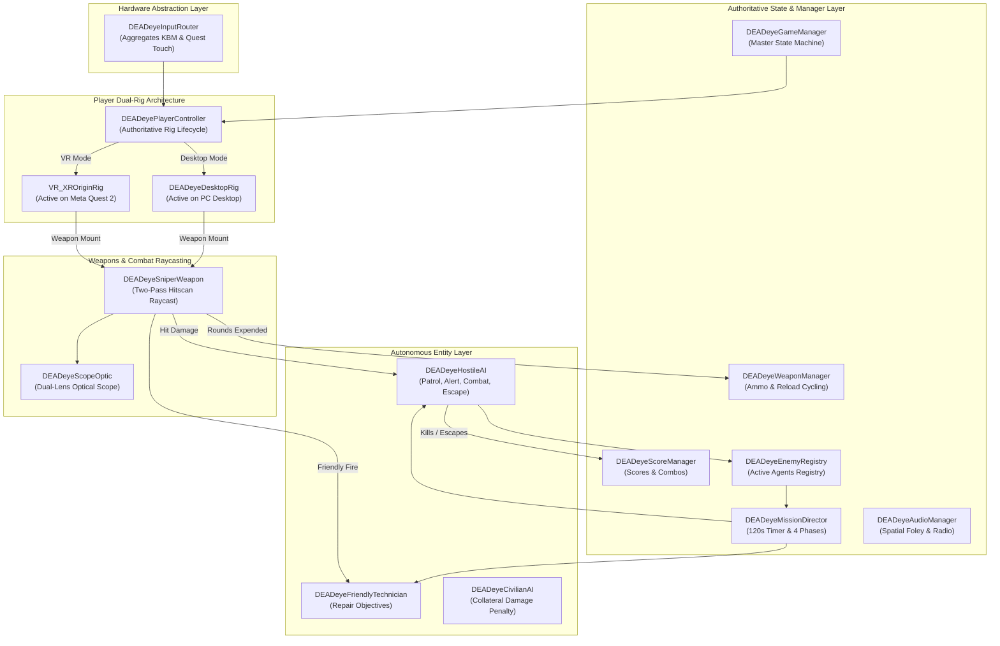

# DEADeye — Technical Architecture Specification

```
========================================================================================
MODULE       : High-Level System Architecture, State Machines & Manager Pipelines
ENGINE       : Unity 6.3 LTS (6000.3.27f2)
RENDER PIPELINE: Universal Render Pipeline (URP 17.3.0)
SOURCE PATHS : Assets/DEADeye/Scripts/Core/, Assets/DEADeye/Scripts/Player/
SCENE        : Assets/DEADeye/Scenes/RooftopMission.unity
========================================================================================
```

---

## 1. High-Level Architectural Blueprint

DEADeye is engineered on a modular, decoupled architecture following SOLID design principles. Core gameplay systems communicate across explicit event delegates and controlled state managers rather than tight component coupling:



---

## 2. Core Manager Singletons

All primary subsystems operate as persistent or scene-bound singletons inheriting the authoritative lifecycle pattern:

```csharp
public static DEADeyeSubsystem Instance { get; private set; }

private void Awake()
{
    if (Instance != null && Instance != this)
    {
        Destroy(gameObject);
        return;
    }
    Instance = this;
}
```

### 1. `DEADeyeGameManager.cs`
- **Role**: Master operational state machine and player mode coordinator.
- **Game States**:
  - `Lobby`: Pre-deployment initialization and settings configuration.
  - `Briefing`: Tactical terminal objectives review.
  - `MissionActive`: Active 120-second combat gameplay.
  - `Paused`: Time scale set to $0.0$; input intercepted by pause UI.
  - `Victory`: Quota eliminated or rogue commander neutralized.
  - `Defeat`: Mission timer expired, 3 hostiles escaped, or allied technicians neutralized.
- **Platform Auto-Detection**:
  ```csharp
  #if UNITY_ANDROID && !UNITY_EDITOR
      playerMode = DEADeyePlayerMode.VR;
  #else
      playerMode = DEADeyePlayerMode.Desktop;
  #endif
  ```

### 2. `DEADeyeMissionDirector.cs`
- **Role**: Coordinates the 120-second mission clock, hostile spawn waves, objective state transitions, and environmental events across Operation DEAD AIR.
- **Event Dispatching**:
  - `OnPhaseChanged(MissionPhase newPhase)`
  - `OnMissionTimerUpdated(float remainingSeconds)`
  - `OnHostileEscaped(int totalEscapes, int maxAllowed)`
  - `OnMissionCompleted(bool isVictory)`

### 3. `DEADeyeWeaponManager.cs`
- **Role**: Tracks operational ammunition state, reload cycles, and magazine capacities.
- **Key Parameters**:
  - `magazineCapacity`: 5 rounds.
  - `reloadDuration`: 2.2 seconds.
  - `isReloading`: Boolean gate rejecting shot execution during magazine cycling.

### 4. `DEADeyeScoreManager.cs`
- **Role**: Evaluates operational score, accuracy percentages, kill streaks, and debriefing ranks.
- **Scoring Rules**:
  - Body hit elimination: $+100\text{ pts}$.
  - Precision headshot elimination: $+300\text{ pts}$.
  - Environmental sabotage: $+150\text{ pts}$.
  - Collateral civilian casualty: $-500\text{ pts}$.
  - Hostile escape penalty: $-200\text{ pts}$.

### 5. `DEADeyeAudioManager.cs`
- **Role**: Centralized procedural audio synthesis and spatial audio bus routing.
- **Acoustic Design**: High-impact sniper gunshot Foley, optical scope zoom chimes, dry-fire safety clicks, electrical power junction arc bursts, ambient metropolitan drone hums, and radio communication squawks.

---

## 3. Dual-Rig Player Subsystem

A primary engineering accomplishment in DEADeye is the strict separation between the desktop simulator and mobile VR rigs within a single unified scene:

```csharp
public void EnforceActiveRig(DEADeyePlayerMode? explicitMode = null)
{
    DEADeyePlayerMode mode = explicitMode ?? DEADeyeGameManager.Instance.PlayerMode;

    if (mode == DEADeyePlayerMode.VR)
    {
        if (desktopRig != null) desktopRig.gameObject.SetActive(false);
        if (vrRig != null)
        {
            vrRig.SetActive(true);
            ConfigureVRRigAndTracking();
            AttachWeaponToVRHand();
        }
    }
    else
    {
        if (vrRig != null) vrRig.SetActive(false);
        if (desktopRig != null)
        {
            desktopRig.gameObject.SetActive(true);
            AttachWeaponToDesktopRig();
        }
    }
}
```

### Mutually Exclusive Guarantees
- Only **one** player rig GameObject is active in the hierarchy at any time.
- Input routes dynamically to the active rig: mouse look writes to `desktopRig.cameraPivot.localRotation`, while OpenXR writes directly to `vrRig.MainCamera.transform.localRotation`.
- The physical sniper rifle model is automatically reparented to either the desktop weapon socket (`Desktop_FPSRig/CameraPivot/WeaponHolder`) or the VR right hand socket (`VR_XROriginRig/Camera Offset/Right Controller/VRWeaponSocket`).

---

## 4. Boundary Enforcement & Level Stability

Stationary elevated sniping requires strict boundary constraints to prevent operatives from falling through geometry into void space:

### `DEADeyeRooftopBoundary.cs`
- Evaluates the active rig position every frame in `LateUpdate()`.
- Calculates spatial bounds against a $64\text{ m} \times 24\text{ m} \times 40\text{ m}$ safe bounding volume.
- **Safety Interception**: If the operative drops below $18.0\text{ m}$ altitude (e.g., slipping off a bridge edge), the boundary controller disables the `CharacterController`, sets coordinates to the nearest safe perch node (Perch 1, 2, or 3), and re-enables physics—guaranteeing zero game crashes or floor-falling glitches.
