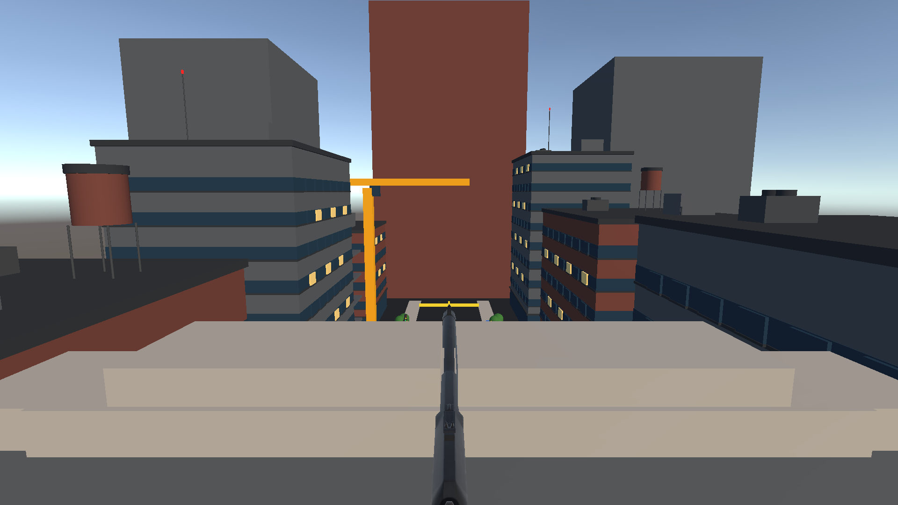
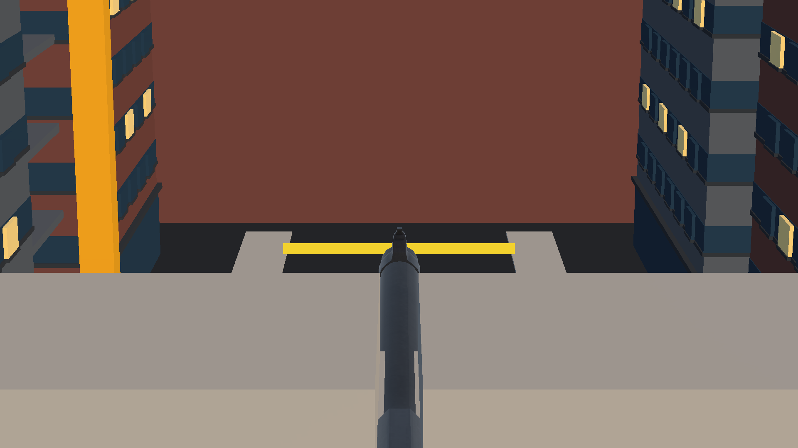
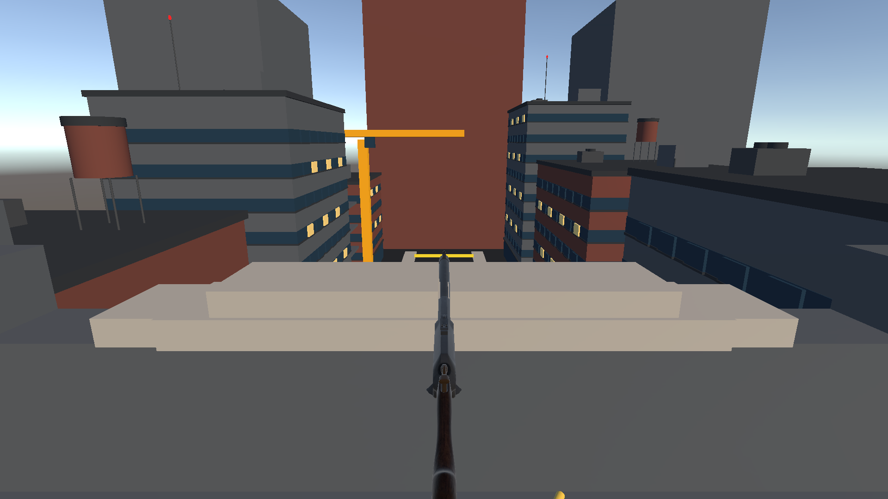
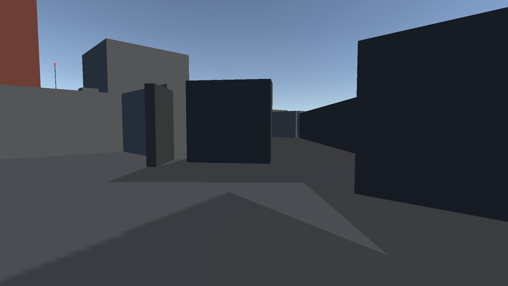
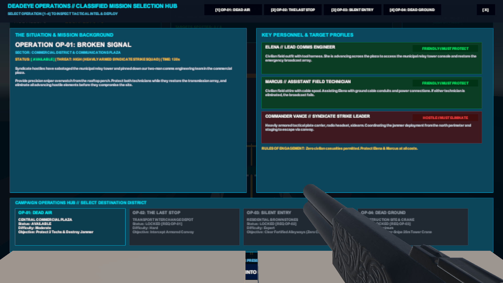
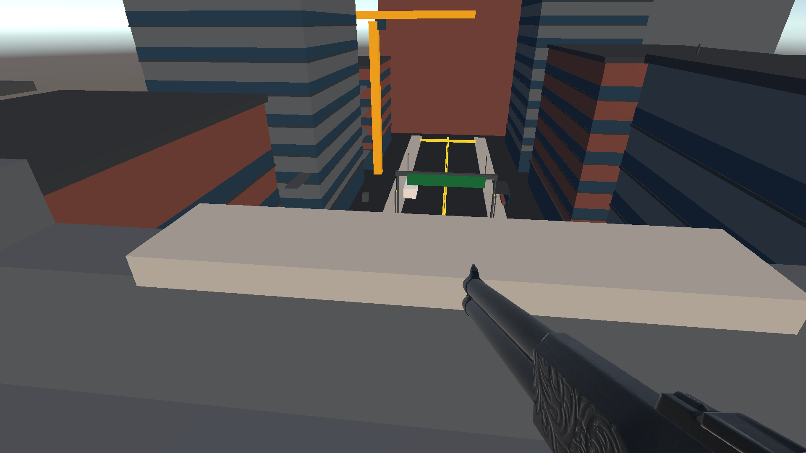
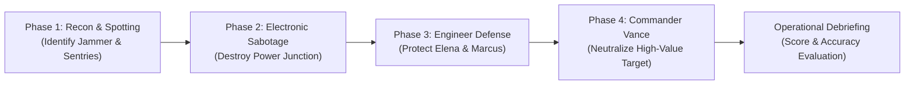

# DEADeye — Urban Tactical Operations

```
========================================================================================
  ____  _____    _    ____                      
 |  _ \| ____|  / \  |  _ \  ___ _   _  ___     
 | | | |  _|   / _ \ | | | |/ _ \ | | |/ _ \    
 | |_| | |___ / ___ \| |_| |  __/ |_| |  __/    
 |____/|_____/_/   \_\____/ \___|\__, |\___|    
                                 |___/          
========================================================================================
 TACTICAL FIRST-PERSON URBAN SNIPER SIMULATION & 6DoF STANDALONE VIRTUAL REALITY
========================================================================================
```

[](https://unity.com/)
[-blue.svg)](https://unity.com/srp/Universal-Render-Pipeline)
[](https://www.khronos.org/openxr/)
[](https://www.meta.com/quest/products/quest-2/)
[-brightgreen.svg)]()
[](LICENSE)

**DEADeye** is a tactical first-person urban sniper game developed in **Unity 6.3 LTS (`6000.3.27f2`)** for **Meta Quest 2 standalone VR** (Android ARM64 / Khronos OpenXR) and **PC Desktop** (keyboard & mouse simulator).

Departing from conventional shooting-gallery games, DEADeye places the operative in an elevated rooftop overwatch complex at an altitude of 26 meters. Interconnected by open industrial catwalks and structural skybridges, the operative commands panoramic line-of-sight over an active metropolitan sector during **Operation DEAD AIR**—a high-stakes covert mission requiring positive target identification, electronic disruption, defensive overwatch, and high-value target neutralization under a 120-second operational clock.

---

## 📸 In-Game Visuals

| Urban Overwatch Skyline | Precision Optical Scope |
|:---:|:---:|
|  |  |
| *26-meter rooftop nest overlooking metropolitan roadway network* | *High-magnification dual-lens optical zoom with crosshair reticle* |

| Tactical Sniper Armament | Walkable Rooftop Catwalks |
|:---:|:---:|
|  |  |
| *XM500 bolt-action precision rifle with matte non-reflective finish* | *Open-grated steel catwalk connecting Perch 1 with East Overwatch* |

| Tactical Terminal Interface | Operational Debriefing |
|:---:|:---:|
|  |  |
| *Interactive in-game operations terminal and mission selector* | *Comprehensive post-operation telemetry and accuracy evaluation* |

---

## 🎯 About the Game

### Core Gameplay Experience
- **Tactical Elevated Overwatch**: The operative occupies a continuous 26-meter rooftop perimeter comprising **Perch 1 (North Main)**, **Perch 2 (East Plaza Overlook)**, and **Perch 3 (West Construction Zone)**. Spatial safety boundaries prevent falling into street-level void geometry.
- **Two-Pass Ballistics Pipeline**: Ballistics are evaluated through a two-pass hitscan pipeline that eliminates camera-muzzle parallax errors and prevents wall-clipping exploits.
- **Mandatory Scope Fire Gate**: Hip-firing is physically disabled. Discharging the weapon requires looking through the dual-lens optical scope to acquire positive target identification.
- **Dynamic Urban AI**: Street-level hostiles navigate realistic patrol routes using NavMesh pathfinding. Agents transition across Patrol, Alert, Combat, and Escape states, dynamically investigating gunshots and searching for cover.
- **Procedural Locomotion Animation**: Limbs oscillate via dynamic trigonometric functions ($0 budget, sub-56 MB APK size), scaling stride cadence to NavMesh velocity.
- **Target Spotting & Reconnaissance**: Operatives use optical magnification to designate hostile communications arrays, rogue commanders, and armed sentries with persistent HUD markers.

---

## 🎖️ Campaign: Operation DEAD AIR

The vertical slice features the complete covert military engagement **Operation DEAD AIR**, structured as four sequential tactical phases:



1. **Phase 1 — Reconnaissance & Acquisition**: Scan street traffic; spot the military communications jammer and perimeter sentries.
2. **Phase 2 — Electronic Disruption**: Locate the auxiliary high-voltage junction box and sever power to the jammer with precision fire.
3. **Phase 3 — Defense of Allied Engineers**: Provide overwatch protection for allied field technicians Elena and Marcus while they restore satellite array feeds.
4. **Phase 4 — Neutralize Commander Vance**: Identify rogue commander Vance among armed escorts and neutralize him before he reaches an extraction vehicle.

---

## 🕹️ Control Schemes

DEADeye supports complete input parity between desktop keyboard/mouse and standalone Meta Quest 2 Touch controllers:

### PC Desktop Simulator Controls

| Input | Action | Behavior |
|---|---|---|
| **Mouse Look** | Aim / Free Look | Rotates camera pitch and yaw; cursor locked to viewport. |
| **W / A / S / D** | Locomotion | Traverses operative across perches, catwalks, and skybridges. |
| **Hold RMB** | Optical Scope | Engages dual-lens sniper optic ($12^\circ$ or $6^\circ$ FOV). |
| **LMB (Scoped)** | Fire Rifle | Discharges 1 round; executes two-pass ballistic raycast. |
| **LMB (Unscoped)** | Fire Blocked | Gated; emits audible safety click and HUD warning. |
| **R** | Reload Magazine | Replenishes 5-round magazine over 2.2 seconds. |
| **Space** | Jump | Traverses minor steps and platform transitions. |
| **Y** | Tactical Terminal | Toggles interactive mission operations terminal. |
| **Escape** | Pause / Settings | Halts simulation; displays pause interface. |

### Meta Quest 2 Standalone VR Controls

| Controller | Input Control | In-Game Action |
|---|---|---|
| **Headset (6DoF)** | Physical Head Rotation | 360° Free Look via direct OpenXR CenterEye polling. |
| **Right Hand** | **Hold Grip** | Engage Optical Scope Zoom. |
| **Right Hand** | **Index Trigger** | Fire Sniper Rifle (While Scoped). |
| **Right Hand** | **Button A** | Reload 5-Round Magazine. |
| **Right Hand** | **Button B** | Toggle Mission Objectives HUD. |
| **Left Hand** | **Left Thumbstick** | Smooth Locomotion Across Rooftop Bridges. |
| **Left Hand** | **Button X** | Alternative Reload Magazine. |
| **Left Hand** | **Button Y** | Toggle Tactical Terminal UI. |
| **Left Hand** | **Menu Button** | Pause Mission Simulation. |

---

## 🏛️ System Architecture

DEADeye is structured on a decoupled, modular architecture adhering to SOLID design principles:

```
DEADeyeVR/
├── Assets/
│   ├── DEADeye/
│   │   ├── Art/              # Quaternius characters, XM500 rifle, urban architecture
│   │   ├── Audio/            # 16-bit 44.1kHz spatial sound effects & Foley
│   │   ├── Editor/           # Automated build pipelines & scene inspection
│   │   ├── Prefabs/          # Rigs, characters, weapons, HUD elements
│   │   ├── Scenes/           # RooftopMission.unity (Authoritative build scene)
│   │   ├── Scripts/
│   │   │   ├── AI/           # Hostile FSM, procedural animation, indicators
│   │   │   ├── Core/         # GameManager, InputRouter, AudioManager, ScoreManager
│   │   │   ├── Environment/  # Procedural city streets, props, boundary enforcement
│   │   │   ├── Mission/      # MissionDirector (120s timer), wave spawns, objectives
│   │   │   ├── Player/       # PlayerController (Dual-rig), DesktopRig, VRRig
│   │   │   ├── UI/           # Tactical terminal, HUD, debriefing, pause menu
│   │   │   └── Weapons/      # Ballistic sniper rifle, scope optic camera
│   │   └── Tests/            # Automated EditMode & PlayMode NUnit test suites
│   └── Samples/              # OpenXR & XR Interaction Toolkit starter configurations
├── Documentation/            # Complete 12-part technical engineering manual
└── Builds/Android/           # Standalone Meta Quest release packages
```

For comprehensive architectural breakdowns, consult the [Documentation Suite](Documentation/):
- [Technical Architecture Specification](Documentation/TECHNICAL_ARCHITECTURE.md)
- [OpenXR & Meta Quest 2 Engineering](Documentation/VR_AND_OPENXR.md)
- [Weapon Systems & Two-Pass Ballistics](Documentation/WEAPON_AND_BALLISTICS.md)
- [Game AI & Mission Systems](Documentation/AI_AND_MISSION_SYSTEMS.md)
- [Automated Testing & QA Report](Documentation/TESTING.md)

---

## 📦 Installation & Quickstart

### Prerequisites
- **Engine**: Unity 6.3 LTS (`6000.3.27f2`) installed via Unity Hub.
- **Build Modules**: Android Build Support, OpenJDK, Android SDK & NDK Tools.

### 1. Clone the Authoritative Repository
```bash
git clone https://github.com/JeyaVardhan-L/DEADeyeVR.git
cd DEADeyeVR
```

### 2. Launch in Unity Hub
1. Open **Unity Hub** $\rightarrow$ Click **Add** $\rightarrow$ **Add project from disk**.
2. Select the repository root folder.
3. Verify the assigned Editor Version is **`6000.3.27f2`**.
4. Open the project; Unity will automatically resolve package dependencies from `Packages/manifest.json`.

### 3. Run the Desktop Simulator
1. Open `Assets/DEADeye/Scenes/RooftopMission.unity`.
2. Press **Play** in the Unity toolbar.
3. Left-click into the Game viewport to lock the cursor.

### 4. Build Standalone Quest 2 APK (Headless)
Run from PowerShell to compile without opening the Unity Editor GUI:
```powershell
& "C:\Program Files\Unity\Hub\Editor\6000.3.27f2\Editor\Unity.exe" `
  -batchmode -quit `
  -projectPath "." `
  -executeMethod "DEADeye.Editor.DEADeyeAndroidBuilder.BuildQuest2Apk" `
  -logFile "build_quest2.log"
```
The compiled package is output to: `Builds/Android/DEADeye_Quest2.apk` ($55.5\text{ MB}$).

### 5. Sideload onto Headset
```powershell
adb install -r "Builds/Android/DEADeye_Quest2.apk"
```
On your Quest, launch via: **App Library $\rightarrow$ Unknown Sources $\rightarrow$ DEADeye**.

---

## 🧪 Automated Testing & Verification

The project maintains **32 automated tests** executing under the Unity Test Framework and NUnit:

- **EditMode Tests**: **27 / 27 PASSED (100%)** ([`TestResults_EditMode.xml`](TestResults_EditMode.xml))
  - Validates weapon reload timing, magazine capacities, damage multipliers ($3\times$ headshot, $1\times$ body), dual-rig mutual exclusivity, camera clipping planes, and mission state transitions.
- **PlayMode Tests**: **5 / 5 PASSED (100%)** ([`TestResults_PlayMode.xml`](TestResults_PlayMode.xml))
  - Validates ballistic accuracy at $50\text{ m}$, wall obstruction deflection, catwalk bridge traversal, enemy spawn triggers, and victory state flow.
- **Pass Rate**: **32 / 32 (100%)**

Execute the test suite headlessly:
```powershell
& "C:\Program Files\Unity\Hub\Editor\6000.3.27f2\Editor\Unity.exe" `
  -batchmode -projectPath "." -runTests -testPlatform EditMode `
  -testResults "TestResults_EditMode.xml" -logFile "test.log"
```

---

## ⚖️ Current Development Status & Limitations

In keeping with professional engineering integrity:

1. **Vertical Slice Scope**: **Operation DEAD AIR** is the complete, fully playable vertical slice. Operations 02 (*Broken Signal*), 03 (*Black Horizon*), and 04 (*Silent Citadel*) exist as preview cards in the terminal for future campaign expansion.
2. **Animation Architecture**: Characters utilize procedural trigonometric joint oscillation (`DEADeyeProceduralCharacterAnimator.cs`) rather than motion-capture keyframe libraries to maintain a \$0 budget and sub-56 MB package size.
3. **Hardware Ergonomics**: Automated test runs validate mathematical and simulation logic. Long-duration physical comfort (neck fatigue during downward overwatch aiming, controller wrist tilt angles) requires on-headset user testing.

For full technical critique, consult [Known Limitations & Technical Considerations](Documentation/KNOWN_LIMITATIONS.md).

---

## 📜 Credits & Third-Party Attributions

Developed with a strict **\$0.00 budget policy**, incorporating only permissive open-source assets:

- **Character Models**: Quaternius Modular Character Pack ([CC0 1.0 Public Domain](https://creativecommons.org/publicdomain/zero/1.0/)).
- **Firearm Assets**: LowPolyGuns Winchester Model 1887 by TastyTony ([CC-BY 4.0](https://creativecommons.org/licenses/by/4.0/)).
- **Audio Assets**: UI & Foley by Kenney ([CC0 1.0](https://kenney.nl/)) and Freesound community contributors.
- **Engine Packages**: Universal Render Pipeline, OpenXR Plugin, XR Interaction Toolkit, Input System, and AI Navigation under the [Unity Companion License](https://unity.com/legal/licenses/unity-companion-license).

For complete legal attributions, see [Asset Attribution & Licensing Audit](Documentation/ASSET_ATTRIBUTION.md).

---

## 📄 License

The custom codebase and project configuration of DEADeye are licensed under the [MIT License](LICENSE).
Third-party models and packages remain under their respective permissive licenses.
